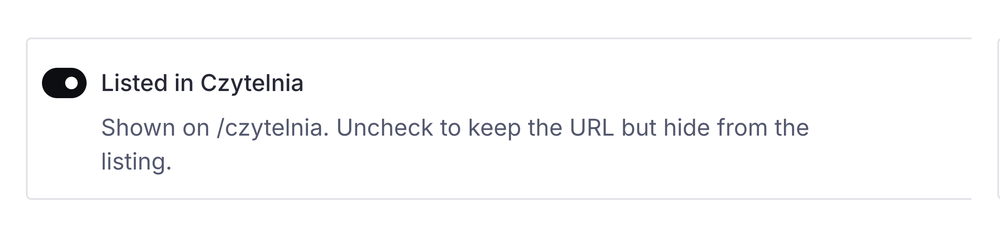

# Czytelnia i O fundacji

## Czytelnia

Tekst Czytelni to dokument **Publication**. Adres: `/czytelnia/` i końcówka z pola Slug.

<!-- screen: czytelnia-dokument | Góra dokumentu Publication: tytuł, slug, Format, Categories, Listed | Widać trzy przełączniki, które decydują o spisie, osobno od samego tekstu -->

**Format** decyduje, w której szufladzie spisu wisi tekst: artykuły, książki, scenariusze, multimedia. Na stronie etykiety są po polsku. W panelu lista jest po angielsku (Articles, Books, Scripts, Multimedia).

**Categories** to etykiety z listy **Category** (w danych nazywają się metodami czytania). To nie jest opis metod na stronie Baza wiedzy i nie jest drugi spis.

**Listed in Czytelnia** włącza tekst do spisu na `/czytelnia`. Odznaczony dokument ma nadal swój adres, ale znika z listy.

<!-- screen: czytelnia-listed | Pole Listed in Czytelnia odznaczone | Widać, że da się zachować adres i schować tekst ze spisu -->

Autorzy to wpisane nazwiska, nie link do dokumentu osoby. PDF, jeśli jest, wisi w polu **File**. Okładka w spisie bierze się z pierwszego obrazka w tekście. Osobnego pola okładki nie ma.

Szczegóły układu spisu (przyciski rodzaju, sekcje kategorii) wynikają z tych pól. Nie ma osobnego ekranu „ułożenia Czytelni” poza dokumentem listingu **Czytelnia** (hero) i samymi publikacjami.

Żeby z Bazy wiedzy (albo z innego tekstu) otworzyć jedną metodę: w treści wstaw **Button**, cel **Dokument**, listing **Czytelnia**, w **Zaawansowane → Parametry** wpisz `kategoria=…` (na przykład `kategoria=teatr-forum`). Tabela slugów i kotwica: [Tekst](tekst.md#zaawansowane-kotwica-i-parametry). Bez parametru wszystkie sekcje są otwarte. Kliknięcie nagłówka sekcji na spisie też zmienia ten adres.

## O fundacji

Dokument **O fundacji**, adres `/fundacja`. Pusta lista w danej grupie chowa cały blok.

<!-- screen: fundacja-grupy | Zakładki dokumentu O fundacji: Hero, Metody i wartości, Zespół, Historia, Dokumenty | Widać, że jedna strona jest podzielona na te pięć grup -->

**Metody i wartości.** Kręgi z krótką nazwą. Pusta lista = brak kręgów. Na telefonie jest jeden przewijany rząd.

**Zespół.** Nagłówek, wybrane osoby (dokumenty Person) i opcjonalny tekst pod zdjęciami. Skład ról w tekście oznaczamy listą Roles, patrz [Tekst](tekst.md). Puste osoby i pusty tekst = brak sekcji. Osobna strona `/zespol` to listing wszystkich osób i nie zastępuje tego bloku.

**Historia.** Lead nad osią jest tekstem sformatowanym. Wpisy mają rok i tytuł. Pusta lista wpisów = brak osi. Nie wklejamy przykładowych lat z makiety.

**Dokumenty.** Każdy wiersz to tytuł plus strona z panelu, plik PDF albo adres. Pusta lista = brak sekcji.

<!-- screen: fundacja-dokumenty | Jeden wiersz dokumentów z tytułem i podpiętym PDF | Widać, że dokument może być plikiem, a nie tylko linkiem do strony -->

## Kontakt

**Kontakt** to zwykła strona (Page). Nie ma formularza. Adresy mailowe na tej stronie biorą się z pól e-mail przy osobach, nie z osobnego formularza.
