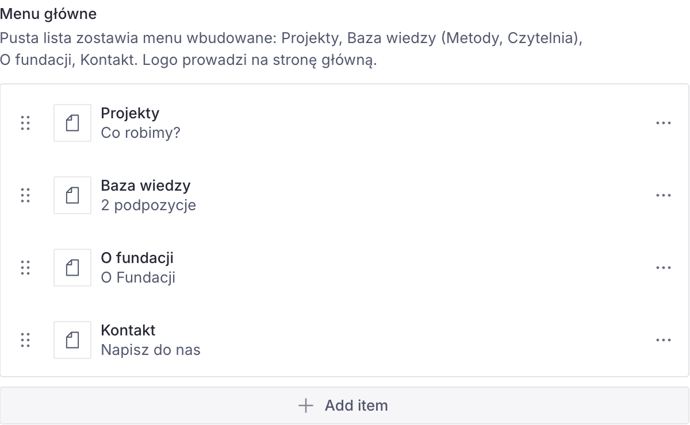
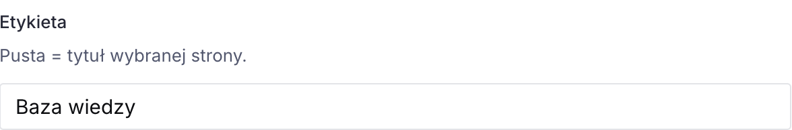
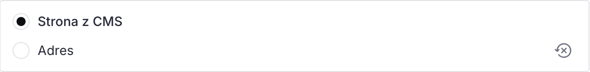
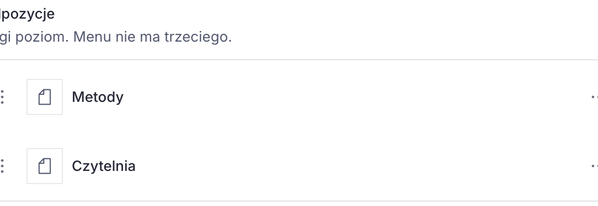
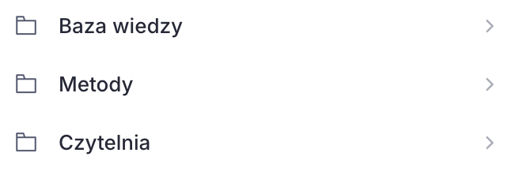

# Menu

Menu witryny ustawia się w **Strona główna → Nawigacja**. To samo ustawienie układa skróty na górze lewej listy w Studio.

<!-- screen: menu-grupa | Grupa Nawigacja z kilkoma wierszami | Widać, że menu jest listą w ustawieniach strony głównej, a nie osobnym programem -->

## Wiersz menu

Każdy wiersz ma etykietę i cel.

**Etykieta.** Pusta = na stronie i w skrócie Studia widać tytuł wybranego dokumentu.

<!-- screen: menu-pusta-etykieta | Wiersz z wybraną stroną i pustym polem etykiety | Widać, że puste pole etykiety bierze tytuł dokumentu -->

**Cel.**

- **Strona z CMS** — wybór istniejącego dokumentu: zwykła strona (w tym Baza wiedzy), projekt, publikacja, osoba, listing (Projekty, Czytelnia, Zespół) albo O fundacji. Aktualności (`aktualnosc-…`) i stare duplikaty projektów nie pojawiają się na liście wyboru.
- **Adres** — ścieżka od ukośnika (`/projekty`) albo pełny `https://…`. Tak dodaje się link poza stronę, na przykład do Centrum.

<!-- screen: menu-adres | Wiersz przełączony na Adres, z wpisanym https | Widać, że link zewnętrzny nie wymaga dokumentu w Studio -->

Kolejność wierszy to kolejność w menu. Przeciąganie działa tak jak na innych listach Sanity: [Array fields](https://www.sanity.io/docs/studio/array-type).

## Drugi poziom

Pod wierszem jest lista **Podpozycje**. To jedyny dodatkowy poziom. Trzeciego nie ma: formularz go nie pokazuje, a strona go nie rysuje.

Rodzic nadal jest linkiem (na przykład Baza wiedzy prowadzi na `/baza-wiedzy`). Podpozycje są obok niego w menu.

<!-- screen: menu-podpozycje | Rozwinięta Baza wiedzy z podpozycją Czytelnia | Widać rodzica i dokładnie jeden poziom dzieci -->

Pozycja, która jest samym adresem i nie wskazuje dokumentu, **nie dostaje skrótu** w lewym nawigatorze. W menu na stronie nadal działa.

## Pusta lista

Pusta Nawigacja zostawia menu wbudowane: Projekty, Baza wiedzy (Czytelnia), O fundacji, Kontakt. Logo i tak prowadzi na stronę główną. Nie dodajemy jej do menu.

Gdy lista coś zawiera, na stronie jest **tylko** to, co wpisane. Żeby wrócić do układu domyślnego, czyścimy listę i publikujemy.

## Skróty po lewej

**Strona główna** jest na górze zawsze, nawet gdy nie ma jej w menu.

Reszta skrótów powtarza Nawigację. Wiersz z podpozycjami otwiera listę: najpierw sam dokument, potem dzieci. Po publikacji menu odśwież kartę Studia, żeby lewa lista się przebudowała.

<!-- screen: menu-skroty-desku | Lewa lista Content po uzupełnionym menu, ze Stroną główną na górze i gałęzią Baza wiedzy | Widać, że skróty idą za menu, a Strona główna zostaje -->

Dopóki Nawigacja jest pusta, skróty są te dotychczasowe, łącznie z Art Generacje. Art Generacje znika z góry, gdy menu jest uzupełnione i tego projektu w nim nie ma. Dokument dalej jest na liście **Project**.
