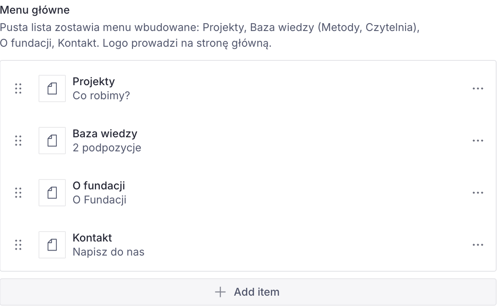
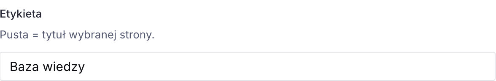
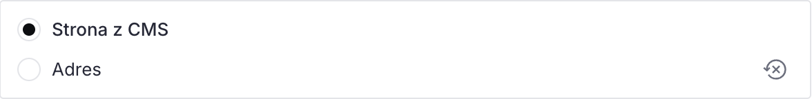
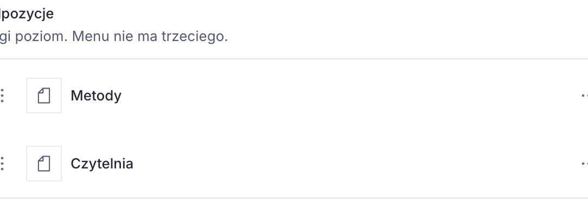
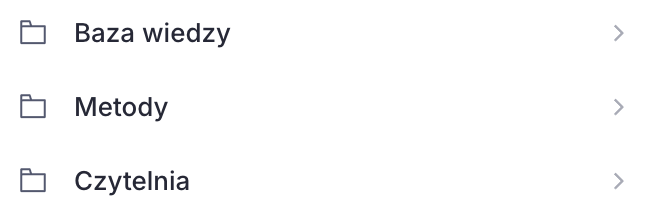

# Menu

Menu witryny ustawia się w **Strona główna** → **Nawigacja**. Ta sama lista układa skróty na górze lewej listy **Content** w Studio.

> **Uwaga.** Dopóki lista **Nawigacja** jest pusta, strona pokazuje menu domyślne (Projekty, Baza wiedzy z podpozycją Czytelnia, O fundacji, Kontakt). Gdy dodasz choćby jeden wiersz, menu domyślne znika i na stronie jest **tylko to, co zostało wpisane na liście**. Dlatego wpisz od razu wszystkie pozycje, które mają zostać, i dopiero potem opublikuj.

<!-- screen: menu-grupa | Grupa Nawigacja z kilkoma wierszami | Widać, że menu jest listą w ustawieniach strony głównej, a nie osobnym programem -->

## Jak dodać pozycję

1. Otwórz **Strona główna** → zakładka **Nawigacja**.
2. Naciśnij **Add item**.
3. Wybierz **Cel** (opis niżej) i wskaż stronę albo wpisz adres.
4. Wpisz **Etykietę**, czyli napis w menu. Przy celu **Strona z CMS** możesz ją zostawić pustą: menu pokaże wtedy tytuł wybranej strony. Przy celu **Adres** etykieta jest wymagana.
5. Ustaw kolejność, przeciągając wiersze. Kolejność na liście to kolejność w menu.
6. Naciśnij **Publish**.

Strony głównej nie dodajesz do menu: prowadzi na nią logo w nagłówku.

<!-- screen: menu-pusta-etykieta | Wiersz z wybraną stroną i pustym polem etykiety | Widać, że puste pole etykiety bierze tytuł dokumentu -->

## Cel pozycji

- **Strona z CMS**: wybierasz istniejący dokument. Może to być zwykła strona (w tym Baza wiedzy), aktualność, projekt, publikacja, osoba, listing (Projekty, Czytelnia, Zespół) albo O fundacji. Stare duplikaty projektów nie pokazują się na liście wyboru.
- **Adres**: ścieżka od ukośnika (`/projekty`) albo pełny adres `https://…`. Ścieżka może zawierać kotwicę, czyli `#` i identyfikator sekcji, np. `/fundacja#historia-fundacji`. Nie wklejaj adresu podglądu `dramaway.netlify.app` — linki do stron tego serwisu powinny być ścieżkami od `/`. Każdy link otwiera się w tej samej karcie. W ten sposób dodaje się link poza stronę, na przykład do Centrum.

### Link do zajawki projektu

Zajawki projektów na automatycznej liście mają kotwice odpowiadające slugom dokumentów typu **Project**. Kafelki tekstowe w sekcjach CMS na stronie **Projekty** mają kotwice tworzone z ich tytułów: tytuł „Projekt Syrena” ma adres `/projekty#projekt-syrena`. Aby pozycja menu prowadziła do tej zajawki, ustaw jej cel na **Adres** i wpisz `/projekty#projekt-syrena`. Otworzy to stronę Projekty w tej samej karcie i przewinie do kafelka.

### Linki do Bazy wiedzy

Esej o metodach (długi tekst pod hero) ma kotwicę `/baza-wiedzy#metody`, sekcja **Polecane publikacje** — `/baza-wiedzy#polecane`, a **Pełna biblioteka** — `/baza-wiedzy#pelna-biblioteka`. Aby dodać je do menu, ustaw cel każdej pozycji lub podpozycji na **Adres**, wpisz odpowiedni adres i opublikuj menu.

Na stronie **O fundacji** możesz użyć adresów (kotwica „Zarząd” prowadzi do sekcji obejmującej Zarząd i Zespół):

- `/fundacja#wartosci` — wartości
- `/fundacja#ludzie` — Zarząd i Zespół
- `/fundacja#historia-fundacji` — historia fundacji
- `/fundacja#dokumenty` — dokumenty

Każda pozycja menu z celem **Adres** może prowadzić do takiej sekcji — także podpozycja. Wpisz ścieżkę strony, `#` i identyfikator sekcji. Identyfikatory są przypisane do sekcji w serwisie; dla kafelków w sekcjach CMS na stronie Projekty są tworzone z tytułu, np. `/projekty#projekt-syrena`.

<!-- screen: menu-adres | Wiersz przełączony na Adres, z wpisanym https | Widać, że link zewnętrzny nie wymaga dokumentu w Studio -->

## Podpozycje

Pod każdym wierszem jest lista **Podpozycje**. Daje to jeden dodatkowy poziom menu, a nie więcej: formularz nie pokazuje trzeciego poziomu i strona go nie rysuje. Pod jednym wierszem może być do ośmiu podpozycji.

Wiersz nadrzędny nadal jest zwykłym linkiem. Na przykład Baza wiedzy prowadzi na `/baza-wiedzy`, a jej podpozycja Czytelnia rozwija się pod nią.

<!-- screen: menu-podpozycje | Rozwinięta Baza wiedzy z podpozycją Czytelnia | Widać rodzica i dokładnie jeden poziom dzieci -->

## Jak wrócić do menu domyślnego

Wyczyść listę **Nawigacja** (usuń wszystkie wiersze) i opublikuj.

## Skróty po lewej w Studio

- **Strona główna** jest na górze zawsze, także wtedy, gdy nie ma jej w menu.
- Pozostałe skróty powtarzają menu. Pozycja z podpozycjami otwiera listę: najpierw sama strona, potem jej podpozycje.
- Pozycja, która jest samym adresem i nie wskazuje dokumentu, nie dostaje skrótu w Studio. W menu na stronie działa normalnie.
- Po opublikowaniu menu odśwież kartę Studia, żeby lewa lista się przebudowała.

Dopóki **Nawigacja** jest pusta, skróty są dotychczasowe: Projekty, Czytelnia i Zespół (listingi), Art Generacje, Baza wiedzy, Kontakt i O fundacji. Gdy menu jest uzupełnione, a Art Generacje w nim nie ma, skrót do tego projektu znika z góry listy. Dokument zostaje na liście **Project**.

<!-- screen: menu-skroty-desku | Lewa lista Content po uzupełnionym menu, ze Stroną główną na górze i gałęzią Baza wiedzy | Widać, że skróty idą za menu, a Strona główna zostaje -->

