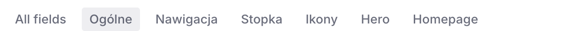
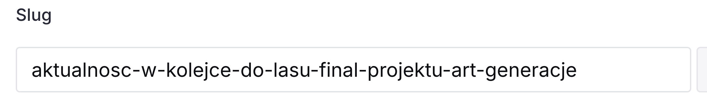
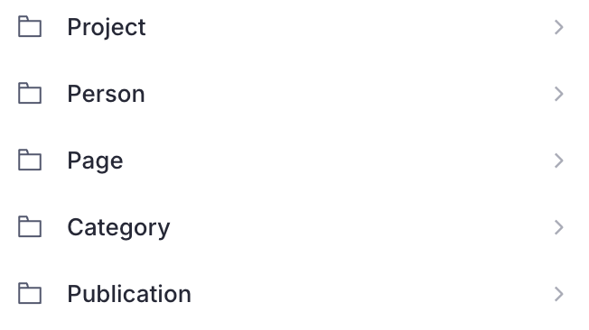

# Który dokument jest którą stroną

Skrót po lewej otwiera jeden dokument. Ten dokument składa konkretny adres na stronie. Puste pole znika: nie pokazujemy wtedy pustego nagłówka ani pustego przycisku.

<!-- screen: strony-skroty | Góra listy Content ze skrótami | Widać, że Strona główna, listingi i O fundacji są osobnymi pozycjami, nie jedną „stroną o wszystkim” -->

## Strona główna

Skrót **Strona główna** (na dole listy ta sama rzecz nazywa się **Site settings**).

Grupy:

- **Ogólne** — tytuł witryny.
- **Nawigacja** — menu. Osobna instrukcja: [Menu](menu.md).
- **Stopka** — logo, adres, cytat.
- **Ikony** — ikona karty przeglądarki i obrazek do udostępniania. Zwykle zostaje przy utrzymaniu.
- **Hero** — duży nagłówek strony startowej, lead, przycisk, zdjęcie.
- **Sekcje** — lista bloków pod dużym nagłówkiem. Jak je dodawać: niżej, rozdział [Sekcje](#sekcje).

<!-- screen: strony-glowna-grupy | Dokument Strona główna z widocznymi zakładkami grup | Widać Nawigacja, Stopkę, Hero i Sekcje jako osobne karty jednego dokumentu -->

Aktualności nie są osobnym typem dokumentu. To zwykłe strony **Page**, których adres wewnętrzny zaczyna się od `aktualnosc-`. Na liście widać je jak inne strony. Na witrynie zbiera je sekcja **Aktualności**, opisana niżej.

<!-- screen: strony-aktualnosc | Lista Page z dokumentem, którego slug zaczyna się od aktualnosc- | Widać, że news nie ma własnej półki, tylko przedrostek w adresie -->

## Sekcje

Sekcja to blok pod dużym nagłówkiem: kilka kafelków albo lista najnowszych rzeczy. Kolejność na liście w Studio jest kolejnością na stronie. Pusta lista nic nie dodaje.

Są dwa miejsca:

1. **Strona główna** → zakładka **Sekcje** → lista **Sekcje**. Bloki wchodzą pod duży nagłówek.
2. Dokument **Page** (Kontakt, Metody, statut i inne zwykłe strony) → pole **Sekcje**, nad treścią artykułu. Na aktualności (`aktualnosc-`) tego pola nie ma.

Na liście: **Add item**, potem **Kafelki** albo **Aktualności**. Wiersz da się przeciągnąć. Na stronę wychodzi dopiero po **Publish**.

<!-- screen: strony-sekcje | Lista Sekcje z jednym wierszem Kafelki i jednym Aktualności | Widać, że nowy blok dodaje się do listy, a nie jako osobny dokument -->

### Kafelki

Do trzech kafelków w jednej sekcji. Każdy kafelek to tytuł, krótki opis i etykieta linku. Cały kafelek prowadzi w jedno miejsce. Nie da się osobno podlinkować przycisku i tytułu.

Cel kafelka:

- **Dokument z CMS** — istniejąca strona, projekt, publikacja, osoba, listing (Projekty, Baza wiedzy, Czytelnia, Zespół) albo O fundacji.
- **Adres** — ścieżka od ukośnika (`/projekty`) albo adres `https://`.

Pusty **Tytuł** bierze tytuł dokumentu. Pusty **Opis** bierze zajawkę dokumentu. Pusta **Etykieta linku** to „zobacz” przy osobie i projekcie, a „czytaj więcej” przy reszcie.

Bez zdjęcia jest pole **Układ tekstu**:

- **Siatka** — do trzech kolumn obok siebie. Na wąskim ekranie jeden kafelek pod drugim.
- **Lista** — jeden pod drugim, szersza kolumna na środku.

Ze **Zdjęciem** układ tekstu znika. Strona kadru ustawia się sama: pierwsze zdjęcie w danej liście sekcji po lewej, następne po prawej, i tak na zmianę. Tego nie wybiera się ręcznie. Przy dwóch lub trzech kafelkach opis na stronie skraca się do trzech linii. Przy jednym kafelek jest wyśrodkowany w pionie obok zdjęcia.

### Aktualności

Nagłówek pusty zostaje jako „Aktualności”.

**Ile najnowszych** to liczba od 1 do 12. Puste pole oznacza 3.

**Rodzaje treści** można zaznaczyć kilka naraz: aktualności, strony, osoby, projekty, publikacje. Puste zaznaczenie oznacza same aktualności (`aktualnosc-`). Na stronie powstaje jedna lista, od najnowszej daty dodania, bez względu na rodzaj.

## Listingi

Cztery dokumenty **Landing page**, przypięte jako skróty, gdy menu jest puste albo gdy są w menu:

| Skrót | Adres |
|-------|--------|
| Projekty | `/projekty` |
| Baza wiedzy | `/baza-wiedzy` |
| Czytelnia | `/czytelnia` |
| Zespół | `/zespol` |

Pola hero (tytuł, lead, przycisk, zdjęcie) są na tym dokumencie. Puste = tego elementu nie ma. Adresu listingu nie da się zmienić: pole strony jest zablokowane po pierwszym zapisie.

<!-- screen: strony-listing | Dokument Projekty z zablokowanym polem strony i pustym tytułem | Widać, że adres jest stały, a pusty tytuł nie wymyśla nagłówka -->

## O fundacji

Skrót **O fundacji**, adres `/fundacja`. Grupy: Hero, Metody i wartości, Zespół, Historia, Dokumenty. Co wpisać w dalszych grupach: [Czytelnia i O fundacji](czytelnia-i-fundacja.md).

## Projekty, osoby, publikacje, zwykłe strony

Niżej na liście są typy, nie pojedyncze skróty:

- **Project** — jeden projekt, adres `/projekty/…`. Art Generacje ma dodatkowo podstrony edycji.
- **Person** — osoba, adres `/zespol/…`.
- **Page** — Kontakt, Metody, strony typu statut, aktualności. Pole **Sekcje** nad artykułem: [Sekcje](#sekcje). Na aktualnościach (`aktualnosc-*`) tego pola nie ma. Metody i Kontakt, gdy są skrótem na górze, znikają z tej listy, żeby nie wisiały dwa razy.
- **Publication** — tekst Czytelni, adres `/czytelnia/…`.
- **Category** — etykieta kategorii w Czytelni, nie osobna strona metody.

<!-- screen: strony-typy | Dolna część listy Content: Project, Person, Page, Category, Publication | Widać, gdzie szukać tekstu, który nie ma własnego skrótu na górze -->

Nowy dokument dostaje adres z pola **Slug**. Slug powstaje z tytułu. Po publikacji nie zmieniamy go bez potrzeby: zmieni się link, który ktoś mógł już dostać.
