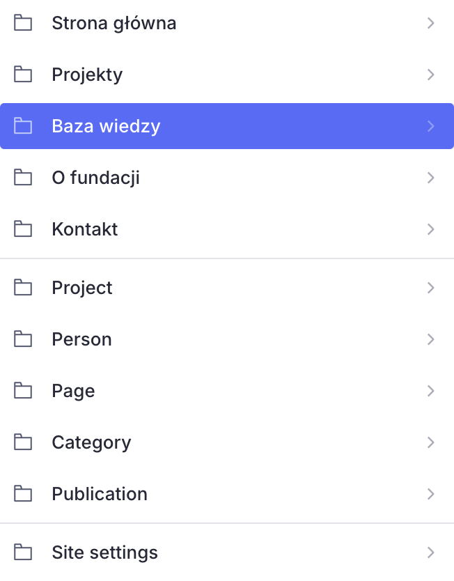
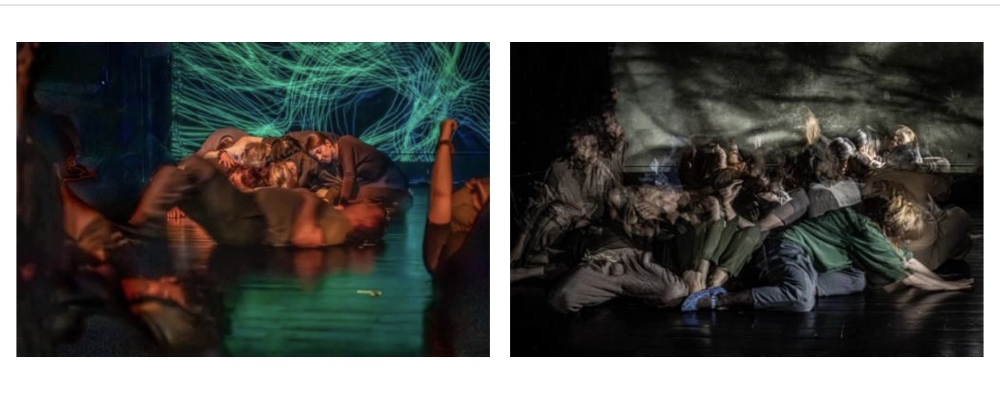

# Podstawy Studia

Studio: <https://dramaway.sanity.studio/>

Logowanie, szkic i przycisk Publish są opisane u Sanity: [Content operations cheatsheet](https://www.sanity.io/docs/user-guides/content-operations-cheatsheet). Poniżej jest tylko to, co trzeba wiedzieć u nas.

<!-- screen: studio-po-zalogowaniu | Lewa kolumna Content po zalogowaniu | Widać skróty na górze (Strona główna i kilka stron) oraz niżej listy Project, Person, Page, Publication -->

## Szkic i publikacja

Zapis w trakcie pracy trzyma **szkic**. Czytelnicy go nie widzą. Na stronę wychodzi dopiero **Publish**.

Przycisk publikacji jest w prawym górnym rogu dokumentu. Zielona kropka **Published** oznacza, że ta wersja jest na stronie. Gdy po publikacji coś jeszcze zmienisz, Studio pokaże, że masz nowszy szkic niż to, co jest na stronie.

<!-- screen: studio-publish | Prawy górny róg dokumentu ze stanem Published i przyciskiem Publish | Widać, gdzie kończy się szkic, a zaczyna wersja dla czytelników -->

Jak szkic różni się od wersji na stronie: [Drafts](https://www.sanity.io/docs/content-lake/drafts).

## Zdjęcia

Pole obrazka przyjmuje plik, podpis (alt) i kadr (hotspot). Alt to krótki opis dla osób, które nie widzą zdjęcia. Hotspot mówi, który fragment ma zostać, gdy kadr przytnie brzegi.

<!-- screen: studio-obraz | Otwarte pole obrazka z uzupełnionym alt i zaznaczonym hotspotem | Widać, że sam plik nie wystarcza: jest podpis i punkt kadru -->

Biblioteka wszystkich plików jest w zakładce **Media** na górnym pasku Studia. Stamtąd wybiera się też obrazek przy polu typu image.

<!-- screen: studio-media | Zakładka Media z siatką plików | Widać, że zdjęcia da się znaleźć bez otwierania konkretnej strony -->

Wyjątek: ikona `.ico` (stara ikona karty przeglądarki) nie wchodzi do Media. Wgrywa się ją w polu pliku w ustawieniach strony, grupa **Ikony**. To robi osoba od utrzymania, nie codzienna redakcja.

Zdjęcia w tekście mają rozmiar: Small, Medium (domyślny), Wide. Po zmianie rozmiaru trzeba opublikować dokument.

## Odnośniki

W zdaniu link zaznacza się w pasku edytora (ikona łańcucha). Taki odnośnik może prowadzić na adres `https://…`, na ścieżkę wewnętrzną zaczynającą się od `/` (na przykład `/czytelnia`), na `mailto:` albo `tel:`.

Zielony przycisk z rulką i kropką to **inny** blok: **Button**. Wstawia się go z plusa w tekście, nie z ikony łańcucha. Tam wybiera się dokument, plik albo adres, a kotwicę i parametry dopisuje się w **Zaawansowane**. Krok po kroku: [Tekst](tekst.md#button).

Nie wklejamy adresów zaczynających się od `javascript:` ani od `//`.

Szerszy opis pracy w tekście: [Content operations cheatsheet](https://www.sanity.io/docs/user-guides/content-operations-cheatsheet).

<!-- screen: studio-link | Pasek edytora tekstu z otwartym polem URL linku | Widać, gdzie wpisać ścieżkę wewnętrzną albo adres zewnętrzny -->
