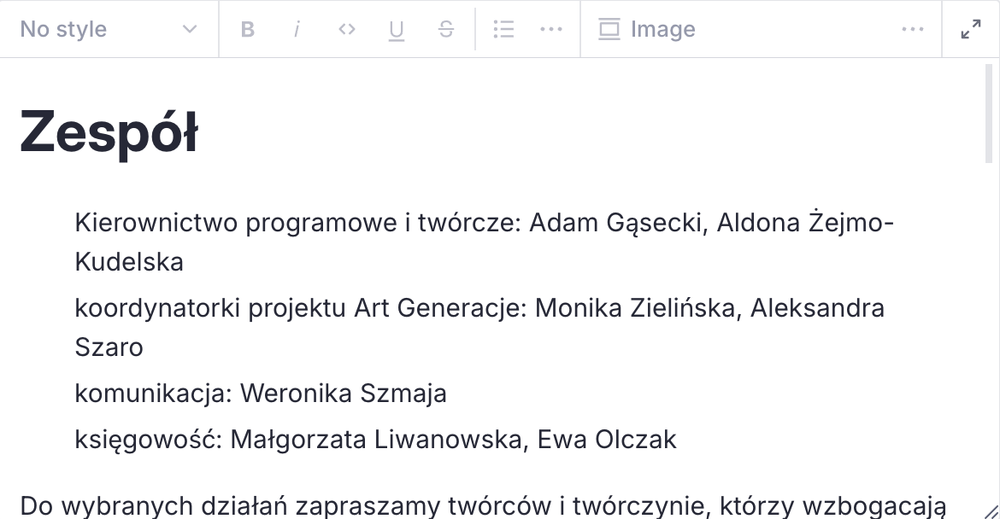

# Tekst

Zwykły akapit, nagłówek, cytat, lista i pogrubienie działają jak w edytorze Sanity. Praca z paskiem: [Content operations cheatsheet](https://www.sanity.io/docs/user-guides/content-operations-cheatsheet).

<!-- screen: tekst-toolbar | Pasek edytora z listą stylów, w tym Termin, oraz list Bullet, Numbered, Indent, Roles | Widać, które pozycje są nasze, a które są zwykłym tekstem -->

Poniżej są tylko dodatki zrobione dla tej strony.

## Termin

Styl **Termin** to hasło w tekście (wyróżniona plama i zwykły krój tekstu). To nie jest cytat. Cytat zostaje stylem **Quote**.

Zaznacz akapit i wybierz Termin. Pogrubienie można dołożyć, ale nie jest wymagane.

<!-- screen: tekst-termin | Akapit oznaczony stylem Termin w edytorze | Widać, że Termin jest stylem akapitu, nie osobnym dokumentem -->

## Wcięcie

Lista **Indent** robi głębsze wcięcie. W edytorze Tab schodzi poziom niżej, tak jak przy zwykłej liście zagnieżdżonej.

<!-- screen: tekst-indent | Lista Indent z dwoma poziomami | Widać, że wcięcie jest rodzajem listy, nie spacjami na początku zdania -->

## Roles

Lista **Roles** jest do wierszy „rola: imiona”, na przykład w składzie zespołu na stronie O fundacji. Każdy punkt to jedna rola, dwukropek oddziela rolę od nazwisk.

Nie zamieniamy na Roles zwykłego zdania, w którym przypadkiem jest dwukropek. Styl trzeba wybrać w pasku.

<!-- screen: tekst-roles | Lista Roles z wierszem „komunikacja: imię i nazwisko” | Widać dwukropek w treści i styl Roles na pasku -->

## Kolumny

Obiekt **Columns** to dwie albo trzy kolumny obok siebie. Na wąskim ekranie układają się jedna pod drugą. W kolumnie może być tekst i zdjęcie. Nie wkładamy kolumn w kolumny ani filmu.

<!-- screen: tekst-columns | Blok Columns ustawiony na dwie kolumny, w każdej krótki akapit | Widać wybór 2 albo 3 i brak trzeciego zagnieżdżenia -->

## Film

Obiekt **YouTube** przyjmuje adres filmu z YouTube. Inne serwisy wideo zostają zwykłym linkiem w tekście, nie odtwarzaczem.
